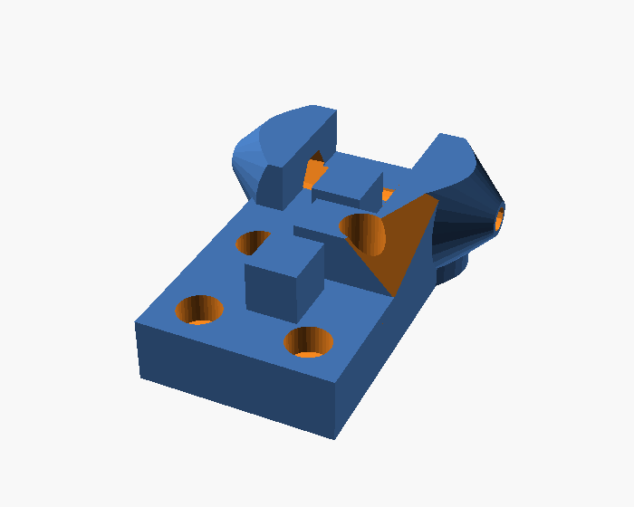

# Carro Kossel Mini para guia MGN9H

Versão do `carriage.scad` original da Kossel ([jcrocholl/kossel](https://github.com/jcrocholl/kossel), feito para MGN12H) para blocos **HIWIN MGN9H**, em duas versões conforme o parafuso de fixação no bloco.



| Arquivo | Parafusos no bloco |
|---|---|
| `carriage_mgn9h_countersunk.stl` | 4 × M3x12 cabeça cônica (escareados faceados a 9mm do bloco) |
| `carriage_mgn9h_socket.stl` | 4 × M3x8 cabeça cilíndrica Allen (assento a 5mm do bloco, cabeça 2mm abaixo da correia) |

## Por que existe

Os carros adaptados que estavam na impressora deixavam o espaçamento entre as juntas das hastes diferente do effector. A peça de calibração XY (5 pinos, quadrado de 90mm) saiu com losango e trapézio; um modelo com as 6 hastes reproduziu as medidas com resíduo de 0,056mm com carros de 39,0 / 42,0 / 38,1mm contra 40mm no effector. Com o bico do Dragon Burner 73mm abaixo das juntas, essa diferença inclina o effector até ~0,8° e distorce a peça em XY; nem o G33 nem o firmware compensam isso.

## O que muda em relação ao original

| | Original (MGN12H) | Este (MGN9H) |
|---|---|---|
| Espaçamento das faces das juntas (`separation`) | 40mm | **40mm** (igual ao effector) |
| Eixo das juntas acima do bloco | 6,5mm | 9,5mm |
| Eixo das juntas acima do perfil da torre | 13 + 6,5 = 19,5mm | 10 + 9,5 = **19,5mm** |
| Correia (do perfil) | 20–25mm | **20–25mm** |
| Furos de fixação | 20 × 20mm | **15 × 16mm** (M3) |
| Comprimento | 40mm | 48mm |

Os chifres das juntas, o parafuso das juntas e a presilha da correia são o código original, deslocados 3mm para cima: a diferença de altura entre MGN12H (13mm) e MGN9H (10mm). Assim a correia continua alinhada com as polias da torre e as juntas ficam na posição do projeto original.

O padrão de furos do MGN9H é mais estreito e, no lugar do original, cairia embaixo da correia e dos chifres. O furo de cima à direita atravessa o bloco que separa as duas presilhas da correia (como no carro original, em que um parafuso atravessa a presilha), com um poço para a cabeça descer até o mesmo nível dos outros três: os quatro parafusos são iguais. As fendas de 2mm onde a correia dobra e trava continuam as do original; ao redor do poço sobram paredes de ~0,4–0,5mm na parte do bloco que não prende a correia. O bloco fica com o centro 26,5mm abaixo do eixo das juntas.

Medidas conferidas no STL gerado: faces dos chifres em x = ±20,00 e eixo em y = 16,00 / z = 9,50, contra x = ±20,00 e y = 16,00 / z = 6,50 no `carriage.stl` original.

## Antes de imprimir

Confira no seu bloco (clones variam):
- altura do trilho + bloco (base do trilho ao topo do bloco): **10mm** (`mgn9h_height`);
- furos: **15mm** na largura e **16mm** no sentido do trilho (`mgn9h_hole_across`, `mgn9h_hole_along`);
- profundidade da rosca dos furos do bloco: os comprimentos abaixo contam com 3mm de rosca.

Se algo diferir, ajuste no `carriage_mgn9h.scad` e gere de novo:

```bash
docker run --rm -u $(id -u):$(id -g) -v $PWD:/w -w /w openscad/openscad:dev \
  openscad --backend=manifold -D 'screw_head="countersunk"' \
  -o carriage_mgn9h_countersunk.stl carriage_mgn9h.scad    # ou "socket" -> carriage_mgn9h_socket.stl
```

## Impressão

- 3 peças (uma por torre). ABS/ASA ou PETG, 4 perímetros, 40% de preenchimento.
- Na posição do arquivo (base na mesa). Não precisa de suporte.

## Montagem

Parafusos por carro, no bloco MGN9H: 4 × M3x12 cabeça cônica (`countersunk`) ou 4 × M3x8 Allen (`socket`). O de cima à direita entra pelo poço do bloco da presilha.

Juntas das hastes: 2 parafusos M3 (um por chifre, do mesmo comprimento usado hoje), cada um com porca M3 no alojamento interno do chifre, como no original.

1. Aparafuse o carro no bloco **antes** de passar a correia: ela passa por cima dos furos da base.
2. Prenda a correia na presilha como no carro original.
3. Juntas das hastes nas faces externas dos chifres, como no effector.

## Depois de montar

O raio da delta muda (a posição das juntas em relação à torre é a do projeto original, não a dos carros antigos):

1. `G28`, conferir a altura com a régua a Z=20 (como na primeira calibração).
2. `G33 V3` completo e `M500`.
3. Teste do cartão no centro para o `M851 Z`.
4. Reimprimir a peça de calibração XY e medir de novo.

## Licença

GPLv3, herdada do projeto da Kossel (jcrocholl/kossel).
