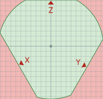

# Fatiadores — Kossel Mini + Dragon Burner

Perfis do OrcaSlicer para a Kossel Mini com o toolhead Dragon Burner (BLTouch `left`) e Marlin 2.1.2.9. Calibração e firmware estão no [README da impressora](../REAME.md).



## Arquivos

| Caminho | O que é |
|---|---|
| `orcaslicer/machine/Kossel Mini Dragon Burner 0.4.json` | Impressora: área imprimível, G-code inicial/final, retração, limites do firmware |
| `orcaslicer/process/0.12mm Fine @Kossel Dragon Burner.json` | Processo 0.12mm |
| `orcaslicer/process/0.20mm Standard @Kossel Dragon Burner.json` | Processo 0.20mm |
| `orcaslicer/process/0.28mm Extra Draft @Kossel Dragon Burner.json` | Processo 0.28mm |
| `orcaslicer/kossel_dragon_burner_bed.svg` | Textura da mesa do Orca (imagem acima) |
| `orcaslicer/install.sh` | Instala os perfis no OrcaSlicer (Linux) |
| `bed_texture_dragon_burner.svg` | Mapa da área segura em Ø210, para fatiadores com mesa circular |

## Área imprimível

O firmware aceita um círculo de Ø210 e **não protege as torres**. O BLTouch encostou na correia da torre X com o bico em r≈90; com 10mm de folga, o bico pode avançar no máximo:

| Direção | Limite do bico (do centro) |
|---|---|
| Torre X (frente-esquerda, lado do BLTouch) | 74,5mm |
| Torre Y (frente-direita) | 83mm |
| Torre Z (trás) | 92mm |
| Entre as torres | 105mm |

No Orca, a área imprimível é o círculo de Ø210 cortado por uma reta diante de cada torre nesses limites (área verde da imagem). Ela é **convexa de propósito**: o Orca só verifica de verdade formas convexas; uma área com reentrâncias seria tratada pelo contorno externo e deixaria passar peças perto das torres. Por isso o recorte fica um pouco menor que a área segura exata (28.700mm² contra 31.000mm²).

Com isso:
- O Orca **recusa** peças fora da área (fatiar dá erro).
- Saia ou brim que passem do limite geram o aviso **"A G-code path goes beyond the plate boundaries."** depois de fatiar. **Não ignore**: afaste a peça da borda. Numa peça encostada no limite da torre X, a saia de 5mm passou 3,4mm do limite.
- Altura máxima: 115mm (com o bico perto das torres, o carro da torre bate no topo antes).

A textura tem as setas e as letras das torres e grade de 10mm; o ponto (0,0) é o centro da mesa.

## Instalar no OrcaSlicer

Testado no OrcaSlicer 2.4.2 (flatpak). Os perfis herdam dos modelos `MyMarlin 0.4 nozzle` e `@MyMarlin` que vêm com o próprio Orca (vendor "Custom").

### Linux

```bash
cd kossel_mini/slicers/orcaslicer
./install.sh                     # detecta o flatpak ou ~/.config/OrcaSlicer
./install.sh /caminho/OrcaSlicer # outra pasta de configuração
```

Se você estiver logado no Orca, os perfis ficam em `user/<seu id>` em vez de `user/default`:

```bash
ORCA_USER_DIR=~/.var/app/com.orcaslicer.OrcaSlicer/config/OrcaSlicer/user/<id> ./install.sh
```

O script copia os JSON, cria os `.info` e aponta a textura para este repositório (a textura não é copiada: se mover o repositório, rode o script de novo). Depois **reinicie o Orca**, selecione a impressora **Kossel Mini Dragon Burner 0.4** e um dos processos `@Kossel Dragon Burner`.

### Outros sistemas (manual)

1. **File → Import → Import Configs...** e selecione os 4 JSON (`machine/` e `process/`).
2. **Printer settings → Basic information → Bed shape → Texture → Load**: escolha `orcaslicer/kossel_dragon_burner_bed.svg`.

### Conferir depois de instalar

1. A mesa aparece com o formato da imagem acima e a textura alinhada (setas nas bordas retas).
2. O tipo de mesa (Plate type) mostra **Textured PEI Plate**. Se o seu PEI for liso, troque para Smooth PEI / High Temp Plate.
3. Arraste um cubo para perto da torre X (frente-esquerda) e fatie: o Orca tem que reclamar.

## Impressora

| Configuração | Valor |
|---|---|
| G-code | `marlin2`, extrusão relativa (`M83`) com `G92 E0` a cada camada |
| Tipo de mesa padrão | Textured PEI Plate (a temperatura vem do perfil de filamento) |
| Retração | 2,8mm a 55mm/s, retorno a 35mm/s, wipe 0,5mm, z-hop 0,4mm só em superfícies de topo |
| Limites da máquina | Os do firmware (acel. 2000, impressão 700, retração 5000, E 500, jerk 10 / E 1,5); `emit_machine_limits_to_gcode` desligado: servem só para estimar o tempo |

A retração veio do perfil antigo da Kossel (bowden, mesmo extrusor); vale refazer o teste de retração do Orca (**Calibration → Retraction test**) com o hotend do Dragon Burner.

G-code inicial:

```gcode
G90
M83
M140 S[bed_temperature_initial_layer_single]
G28
M190 S[bed_temperature_initial_layer_single]
G29 L-80 R70 F-90 B80     ; mesh com todos os pontos a >= 10mm das torres
G1 X0 Y-60 Z10 F3000
M104 S[nozzle_temperature_initial_layer]
M109 S[nozzle_temperature_initial_layer]
G92 E0
G1 X-40 Y-55 Z0.3 F3000   ; purga na frente, longe das torres
G1 X40 Y-55 E15 F1000
G92 E0
G1 Z2 F3000
```

O mesh é sondado com a mesa já quente. Não troque os limites do `G29` sem refazer a conta de folga (ver o README da impressora): com a área de Ø210, um `G29` sem limites ou com outra grade pode levar a cabeça até a correia.

## Processos

Comum aos três: aceleração 700 (paredes externas e topo 500, primeira camada 400, deslocamento 2000, pontes 50%), deslocamento a 120mm/s, saia de 1 volta a 5mm, costura alinhada, arc fitting desligado (o Marlin segmenta arcos na delta).

| | 0.12mm Fine | 0.20mm Standard | 0.28mm Extra Draft |
|---|---|---|---|
| Primeira camada | 0,20mm | 0,25mm | 0,30mm |
| Paredes | 3 | 3 | 2 |
| Topo / fundo | 6 / 5 | 4 / 3 | 3 / 3 |
| Preenchimento | 15% gyroid | 15% gyroid | 12% grid |
| Parede externa / interna | 25 / 40mm/s | 30 / 50mm/s | 35 / 55mm/s |
| Preenchimento / sólido | 50 / 40mm/s | 60 / 50mm/s | 65 / 55mm/s |
| Topo | 20mm/s | 25mm/s | 30mm/s |
| Primeira camada | 15mm/s | 20mm/s | 20mm/s |

As velocidades seguem os perfis antigos da Kossel; o toolhead é bem mais pesado que o J-head, então suba aos poucos.

## Filamento

Os perfis não incluem filamento: use os genéricos do Orca (`Generic PLA @System`, `Generic PETG @System`...) ou os seus. A temperatura da mesa sai do filamento conforme o tipo de mesa; o PLA genérico usa 45°C em PEI, ajuste no perfil do filamento se preferir mais.

## Atualizar os perfis

Ao mudar um perfil no Orca, copie os JSON de volta de `~/.var/app/com.orcaslicer.OrcaSlicer/config/OrcaSlicer/user/default/machine/` e `.../process/` para `orcaslicer/`. O caminho da textura pode ficar como estiver: o `install.sh` reescreve.

## Outros fatiadores

`bed_texture_dragon_burner.svg` tem 210×210mm em escala real para uma mesa circular de Ø210 com origem no centro: verde é a área segura exata, rosa são as zonas das torres. Nesses fatiadores a mesa é o círculo inteiro, então é você quem mantém as peças no verde.
